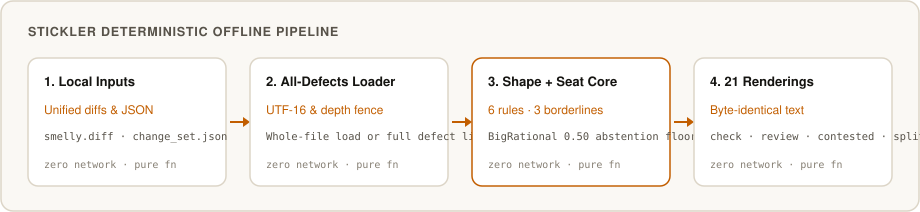

  <picture>
    <source media="(prefers-color-scheme: dark)" srcset="media/stickler-architecture-dark.svg">
    <source media="(prefers-color-scheme: light)" srcset="media/stickler-architecture-light.svg">
    
  </picture>

# Stickler Architecture

Stickler separates fast, zero-cost static smell detection on unified Python diffs from structured multi-model arbitration on ambiguous borderline cases. Every stage runs deterministically in memory over immutable data structures.

## Four-Stage Pipeline

1. **Unified diff and JSON ingestion (`changeset`, `review`, `sets`, `rejudged`, `split`, `json`).** Unified diffs are walked line by line with 1-based raw diff line numbers and hunk-scoped `class` indentation stacks (`CK-5`, `CK-7`). JSON loaders for reviews, change sets, splits, rejudged pairs, and collections accumulate every reachable defect in one pass without panicking.
2. **Six-shape static checker and borderline detector (`checker`).** Added Python lines are tested against six built-in rules (`bare except`, `print call`, `mutable default`, `call default`, `placeholder name`, and `class attribute`) and three borderline heuristics (`near placeholder name`, `broad handler`, and `shared member default`).
3. **Verdict seat arbitration (`verdicts`, `changeset`, `contested`, `rejudged`, `split`).** Borderline flags join against recorded model verdicts (`stickler` vs `clean` choices with `0.5` confidence abstention floor), classifying each flag's standing as `stickler`, `clean`, or `unjudged`, and marking split model outcomes as `contested`.
4. **Twenty-one deterministic renderings (`render`, `cli`, and collection modules).** Pure rendering functions produce line-oriented reports fenced against newline injection (`FIX-CK-21` through `FIX-CK-26`) and closed by exact cross-checked summary totals.

## Module Map

| Module | Responsibility |
| --- | --- |
| `rust/src/cli.rs` | Command dispatch across all twenty-one CLI subcommands, broken-pipe handling, and exit routing |
| `rust/src/checker.rs` | Deterministic Python diff scanner implementing both the six static shapes and the three borderline detectors |
| `rust/src/verdicts.rs` | Parsers for structured `answers.decision` and chat `choices[0].message.content` envelopes (`probabilities` verified) |
| `rust/src/review.rs` | Validator for version 1 single-review JSON objects (`CK-1`, `CK-2`) |
| `rust/src/changeset.rs` | Loader, verdict joiner, and set-review synthesizer for version 1 change set JSON files (`CK-5`..`CK-10`) |
| `rust/src/sets.rs` | Loader for version 1 inline multi-set collection JSON files (`CK-11`, `CK-12`, `FIX-CK-29`) |
| `rust/src/split.rs` | Loader and reading comparing per-route vs joint-route outcomes over one change set (`CK-15`, `CK-16`) |
| `rust/src/rejudged.rs` | Loader and pairwise ledger comparing flag outcomes across two judging passes (`CK-13`, `CK-14`) |
| `rust/src/render.rs` | Central text formatting and line-break fencing layer across single reviews, set reviews, and collection readings |
| `rust/src/census.rs` | Collection-wide tally of sets, files, static judgements, borderline flags, outcomes, and contested counts |
| `rust/src/borderline.rs`, `contested.rs`, `pattern.rs`, `files.rs`, `outcomes.rs`, `verdicts_reading.rs`, `shapes.rs`, `choices.rs`, `categories.rs`, `grounds.rs`, `judgements.rs`, `standings.rs`, `states.rs`, `flags.rs`, `models.rs` | Fifteen focused collection readings slicing judgements, flags, files, and verdict pairs across every analytical axis |
| `rust/src/json.rs`, `pycompat.rs`, `scan.rs` | Depth-guarded JSON parser, Unicode/Python string compatibility helpers, and repository codepoint scanner |

## Determinism and Safety Invariants

- **Read-only inspection.** `stickler` never edits diffs, source files, or collection manifests.
- **Zero configuration drift.** Because the six static rules and three borderline patterns are compiled into the binary, two runs of the same `stickler` version over the same diff always emit identical bytes regardless of working directory dotfiles.
- **Loader and renderer fencing.** File paths, diff labels, set labels, and model names reject embedded newlines at load time, while free-text `flaw`, `rewrite`, and `standard` fields are fenced against `\n` and `\r` at the `render` boundary (`FIX-CK-22`).
