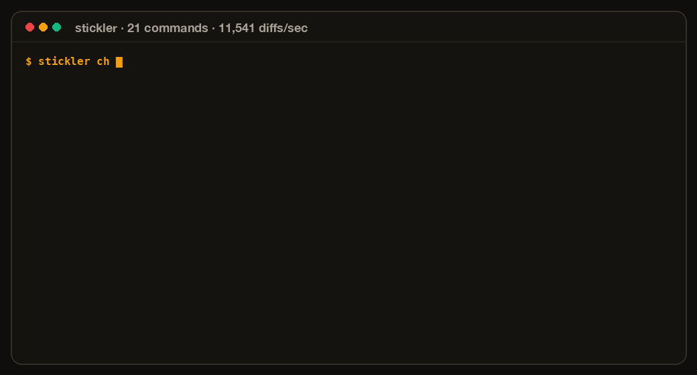

  <picture>
    <source media="(prefers-color-scheme: dark)" srcset="media/stickler-lockup-dark.svg">
    <source media="(prefers-color-scheme: light)" srcset="media/stickler-lockup-light.svg">
    
  </picture>

# Stickler Documentation

Deterministic Python unified-diff smell checker and recorded multi-model verdict analytics.

  

## Documentation Map

| Document | What it covers |
| --- | --- |
| [GUIDE.md](guide.md) | Installation, 60-second walkthrough, categorized command matrix, and multi-agent pipeline recipes |
| [ARCHITECTURE.md](architecture.md) | Four-stage processing pipeline, module map, exact arithmetic guarantees, and input fencing |
| [COMPARISON.md](comparison.md) | Spectacle Line 5-tool boundary matrix and comparison against cloud eval SaaS and scripts |
| [PERFORMANCE.md](performance.md) | Measured release binary size, sub-100ms benchmark latencies, and parser memory bounds |
| [FAQ.md](faq.md) | Scope boundaries, exit codes (`0`, `1`, `2`, `120`), determinism, and troubleshooting |
| [FORMATS.md](formats.md) | Normative version 1 JSON and text input schemas, field rules, and minimal examples |
| [schemas/](https://github.com/david-engelmann/stickler/tree/main/schemas) | Draft 2020-12 JSON Schema definitions (`*.schema.json`) for IDE autocomplete and CI validation |
| [completions/](https://github.com/david-engelmann/stickler/tree/main/completions) | Ready-to-source `bash`, `zsh`, `fish`, and `PowerShell` tab-completion scripts |
| [CONTRACT.md](https://github.com/david-engelmann/stickler/blob/main/CONTRACT.md) | Normative behavioural specification and numbered round obligations |
| [CHANGELOG.md](https://github.com/david-engelmann/stickler/blob/main/CHANGELOG.md) | Release history and packaging milestones |

## Design Guarantees

- **Pure offline execution.** `stickler` makes zero network calls, spawns no background daemons, and mutates none of the diffs or JSON files handed to it.
- **Exact rational thresholds.** Verdict confidence floors (`0.5`) and collection counts run without floating-point rounding drift.
- **Whole-input defect reporting.** Malformed JSON inputs return structured defect lists naming every reachable schema violation before printing a single report line.
- **Single-line output fencing.** Checked string fields reject unpaired UTF-16 surrogates and line breaks (`\n` and `\r`) so untrusted strings cannot forge extra report or summary lines, though operators displaying untrusted text directly in a terminal should still pipe output through a pager or sanitizer.
